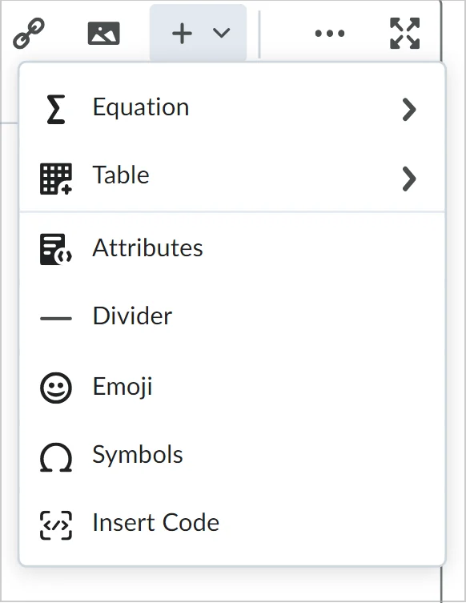
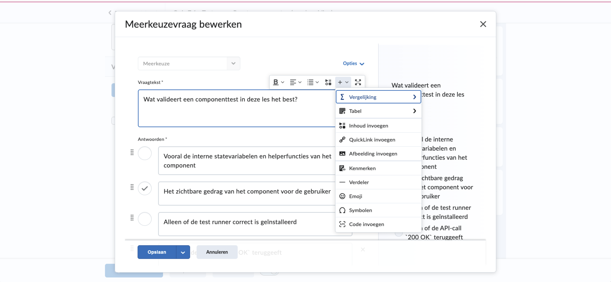
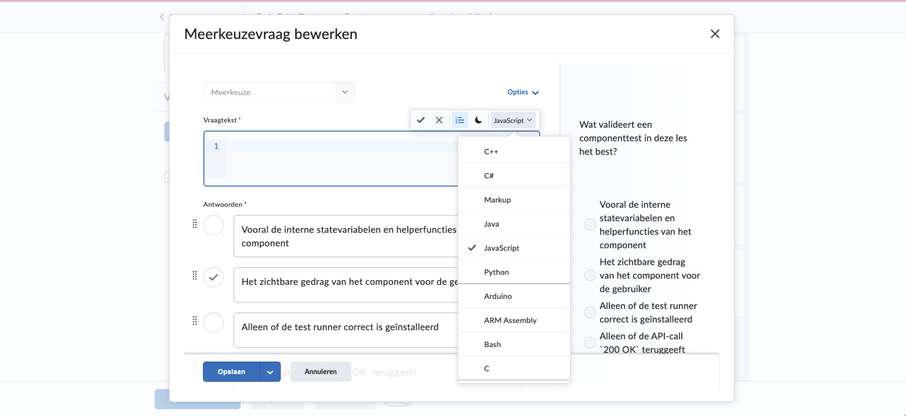

# Task 11 — Quizzosaurus Investigation

**Goal:** Understand the current state of quiz code in BSO and plan tasks 11.5–11.8.

## Summary

Tasks 11.1–11.4 are complete. The git submodule for `remark-kroki-a11y` no longer exists in BSO (no `.gitmodules`, no `vendor/` directory) — **task 11.8 may already be done**, or the submodule was simply never committed. The relevant quizzosaurus code lives in sibling course repos (`owe-1`, `owe-3`) as local copies with a `NOTICE.md` that explicitly calls them temporary.

BSO has a production-quality MC quiz pipeline: `quiz-parser.ts` → `ParsedQuiz` → `quiz-converter.ts` → QTI 1.2 XML, with a matching Docusaurus remark plugin (`quiz-preview.ts`). The quizzosaurus format (`quiz`/`quizz` fenced blocks with `? ! - (x) - [x] =` syntax) is separately defined in `remark-kroki-a11y`'s test-docusaurus-site and produces a well-structured JSON model — the natural candidate for the "quizzosaurus JSON intermediate format" of task 11.6.

---

## 1. Current State of BSO Quiz Code

### Files

| File                    | Role                                                                                             |
| ----------------------- | ------------------------------------------------------------------------------------------------ |
| `src/quiz-parser.ts`    | Parses BSO-format quiz Markdown to `ParsedQuiz`; validates with `validateQuiz`/`assertValidQuiz` |
| `src/quiz-converter.ts` | `ParsedQuiz` → QTI 1.2 XML; `convertQuiz()` writes the file                                      |
| `src/quiz-preview.ts`   | remark plugin: BSO-format quiz → interactive Docusaurus HTML (via `hast`)                        |
| `src/quiz-config.ts`    | Resolves `maxAttempts` / `shuffleAnswers` config with defaults                                   |
| `src/types.ts`          | `QuizConfig`, `ResolvedQuizConfig` interfaces; `BsoConfig.quiz?` field                           |

### Data model

```typescript
// src/quiz-parser.ts

interface QuizQuestion {
  number: number; // author-supplied question number
  text: string; // student-facing prompt
  options: { label: string; text: string }[]; // A–Z labels
  correctAnswer: string; // single uppercase letter
  line?: number; // source line for diagnostics
}

interface ParsedQuiz {
  title: string;
  questions: QuizQuestion[];
  issues?: QuizIssue[]; // parse/validation errors
}
```

This is a **single-choice only** model. There is no `questionType` field, no multiple-correct-answer support, no open-short-answer type, and no hint field.

### Parsing pipeline

```
quiz-*.md
  → parseQuizMarkdown()   (quiz-parser.ts)
  → assertValidQuiz()
  → generateQtiXml()      (quiz-converter.ts) → .xml in build/
  → remarkQuizPreview()   (quiz-preview.ts)   → hast nodes in Docusaurus
```

### BSO quiz Markdown syntax

```markdown
# Quiz 4.3 — Contract-first met OpenAPI

## Vraag 1

Wat betekent "contract-first" bij API-ontwikkeling?

- A. Je legt eerst de API-specificatie vast…
- B. Je schrijft eerst de unit tests…
- C. Je maakt eerst een juridisch contract…
- D. Je bouwt eerst de frontend…
  Correct antwoord: **A**

## Vraag 2

…
```

The parser accepts many label variants: `Vraag`/`Question`, `Correct antwoord`/`Correct answer`/`Antwoord`/`Answer`/`Goede antwoord`/… and letter formats `A`, `**A**`, `` `a` ``, `__A__`. Options may be prefixed `- A.`, `**a)**`, `a)`, `- **A.**` etc. This is documented in `tests/quiz-validation.test.ts`.

### Tests

- `tests/quiz-converter.test.ts` — unit + property tests for QTI output
- `tests/quiz-validation.test.ts` — answer format variants, reject invalid quizzes, shuffle settings, end-to-end `runPrepare`+`runPack` checks

Both test files use Deno's built-in runner + fast-check. They pass with `deno task test:fast`.

---

## 2. Git Submodule Status

**No submodule exists.** There is no `.gitmodules` file and no `vendor/` directory in BSO. The path cited in task 11.1 (`scripts/brightspacosaurus/vendor/remark-kroki-a11y/…`) was a plan note, not an actual checkout.

The Quiz component and quizzosaurus code referenced in tasks 11.2–11.3 was presumably copied directly into course repos:

| Location                                                 | Status                                                                                                                                     |
| -------------------------------------------------------- | ------------------------------------------------------------------------------------------------------------------------------------------ |
| `owe-1/scripts/quizzosaurus/index.js`                    | Present — local copy of the BSO-format quizzosaurus remark plugin                                                                          |
| `owe-3/scripts/quizzosaurus/index.js`                    | Present — identical copy; has `NOTICE.md` explaining it is temporary                                                                       |
| `owe-1/scripts/docusaurus/src/components/Quiz/index.jsx` | Present — standalone React quiz component (different, simpler API: `{ title, questions[{question, options, correctIndex, explanation}] }`) |
| BSO `vendor/`                                            | **Does not exist**                                                                                                                         |

**Conclusion on task 11.8:** If the submodule was never committed to BSO, task 11.8 is a no-op. If it was once present and was already removed, it is done. Either way no action is needed inside BSO.

---

## 3. Two Syntax Formats Side by Side

### Format A — BSO native (current production format)

```markdown
## Vraag 1

Wat is dependency injection?

- A. Een database-patroon
- B. Het van buitenaf aanleveren van afhankelijkheden
- C. Een UI-framework
- D. Een build-tool
  Correct antwoord: **B**
```

- **File convention:** `quiz-*.md` (prefix triggers BSO pipeline)
- **Structure:** H2 headings per question, unordered list for options, `Correct antwoord:` paragraph
- **Question type:** single-choice only
- **Supported in:** BSO QTI export + Docusaurus preview

### Format B — quizzosaurus/quizdown (new format, not yet in BSO)

````
```quiz
? Which diagram type is used for the three-phase overview?
! Look for the diagram with swimlanes and process flow.
- ( ) Activity diagram
- ( ) Class diagram
- (x) Sequence diagram
- ( ) Use case diagram

? Which statements about sequence diagrams are correct?
- [x] They show interactions over time.
- [ ] They replace all class diagrams.
- [x] They can show self-messages.

? Name one participant from the Red Riding Hood story.
! Use one actor/lifeline name.
= wolf / little red / grandmother / huntsman ~20
` ``
````

Syntax rules:

- `? prompt` — question prompt
- `! hint` — optional hint (shown/hidden by button)
- `- ( ) option` / `- (x) option` — single-choice options (radio)
- `- [ ] option` / `- [x] option` — multi-correct options (checkbox)
- `= answer1 / answer2 ~maxLength` — open short-answer
- Fenced block with lang `quiz` or `quizz`

Source: `remark-kroki-a11y/test-docusaurus-site/src/remark/remark-quizdown.mjs` (in the remark-kroki-a11y source checkout at `/Users/bartvanderwal/Code/remark-kroki-a11y/`).

**Key differences:**

| Aspect           | BSO format                                | quizzosaurus format                         |
| ---------------- | ----------------------------------------- | ------------------------------------------- |
| Container        | `quiz-*.md` file                          | `` ```quiz `` fenced block inside any `.md` |
| Question heading | `## Vraag N` / `## Question N`            | `? prompt text`                             |
| Options          | `- A. text` (labelled A–Z)                | `- ( ) text` / `- [ ] text` (no labels)     |
| Correct answer   | `Correct antwoord: **A**` (separate line) | `(x)` inline marker                         |
| Multi-correct    | Not supported                             | `- [x]` checkbox style                      |
| Open answer      | Not supported                             | `= answer1 / answer2 ~maxLength`            |
| Hint             | Not supported                             | `! hint text`                               |
| Question types   | single-choice only                        | single, multiple, open_short                |
| Option labels    | A, B, C, D (explicit)                     | positional (no explicit labels)             |

---

## 4. Quizzosaurus JSON Intermediate Format

The prototype at `remark-quizdown.mjs` already defines a draft JSON format, shown live at https://bartvanderwal.github.io/remark-kroki-a11y/examples/uml-quiz-experimental-syntax (via `debug=true`):

```json
{
  "version": "0.1.0-draft",
  "questions": [
    {
      "id": "q1",
      "prompt": "Which diagram type is used…",
      "questionType": "single",
      "options": [
        { "text": "Activity diagram", "isCorrect": true, "forcedOrder": null },
        { "text": "Class diagram", "isCorrect": false, "forcedOrder": null }
      ],
      "acceptedAnswers": [],
      "maxLength": null,
      "hint": "Look for the diagram with swimlanes…"
    },
    {
      "id": "q2",
      "prompt": "Which statements about sequence diagrams are correct?",
      "questionType": "multiple",
      "options": [
        {
          "text": "They show interactions over time.",
          "isCorrect": true,
          "forcedOrder": null
        },
        {
          "text": "They replace all class diagrams.",
          "isCorrect": false,
          "forcedOrder": null
        }
      ],
      "acceptedAnswers": [],
      "maxLength": null,
      "hint": "Think in terms of time-ordered messages…"
    },
    {
      "id": "q3",
      "prompt": "Name one participant…",
      "questionType": "open_short",
      "options": [],
      "acceptedAnswers": ["wolf", "little red", "grandmother", "huntsman"],
      "maxLength": 20,
      "hint": "Use one actor/lifeline name."
    }
  ],
  "warnings": []
}
```

`questionType` values: `"single"` | `"multiple"` | `"open_short"`.

This format already supports all three question types that BSO currently lacks. It is the natural target for task 11.6.

---

## 5. Where is the Quizzosaurus Code Accessible

| Location                                                                                          | What it contains                                                                          | Notes                                                                                |
| ------------------------------------------------------------------------------------------------- | ----------------------------------------------------------------------------------------- | ------------------------------------------------------------------------------------ |
| `/Users/bartvanderwal/Code/remark-kroki-a11y/test-docusaurus-site/src/remark/remark-quizdown.mjs` | `parseQuizdown()`, `renderQuizHtml()`, `remarkQuizdown()`                                 | Source of truth for quizdown/quizzosaurus format; already used in the live prototype |
| `owe-1/scripts/quizzosaurus/index.js`                                                             | `remarkQuizzosaurus()`, `parseQuestions()`, `renderQuiz()` — BSO format parser            | Parses `## Vraag N` + `- A.` list + `Correct antwoord: X` (plain, no bold)           |
| `owe-3/scripts/quizzosaurus/index.js`                                                             | Identical to owe-1                                                                        | Has `NOTICE.md` calling it a temp copy                                               |
| `owe-1/scripts/docusaurus/src/components/Quiz/index.jsx`                                          | React component with `{title, questions[{question, options, correctIndex, explanation}]}` | Uses `correctIndex` (integer), not label                                             |
| `doex/studenten/packages/quizzosaurus/`                                                           | Thin alias for `quizdown` npm package                                                     | Different project, unrelated                                                         |

**Key difference between owe-1 quizzosaurus and BSO quiz-parser:**
The owe-1 quizzosaurus requires plain `Correct antwoord: X` (no bold, no aliases). BSO's `quiz-parser.ts` accepts 8+ label variants and bold/code/plain formatting. They are divergent; the owe-1 plugin would reject many files that BSO currently accepts.

---

## 6. Existing Tests and Patterns

From `tests/quiz-converter.test.ts` and `tests/quiz-validation.test.ts`:

- Tests use inline fixtures (no external file dependencies — aligned with issue #17)
- Property tests use `fc.record(...)` to generate valid quiz Markdown programmatically
- Unit tests cover: parsing, QTI structure, option labels, shuffle, maxAttempts, `runPrepare`+`runPack`
- The `QUIZ_2_2_DI_FIXTURE` pattern is the reference fixture to follow for new tests
- Tests call `runPrepare(config, false, { skipReaders: true })` to avoid PDF generation
- Coverage target: 80% lines + branch + function coverage

---

## 7. What tasks.md Says About the Quizdown/Quizzosaurus Layering

Task 11.5 references "de SPEC" for the QuizDown/Quizzosaurus-layering. The relevant design intent in the tasks.md is:

> 11.5 Refactor naar eigen npm-module (`quizzosaurus`) op basis van de QuizDown/Quizzosaurus-layering uit de SPEC

The original task notes reference:

- `scripts/brightspacosaurus/vendor/remark-kroki-a11y/test-docusaurus-site/src/components/Quiz/` as the source
- A "branch by abstraction" pattern: introduce a `quizzosaurus`-format parser WITHIN quiz Markdown, then use it to generate both interactive JavaScript quizzes and QTI XML

The owe-3 `NOTICE.md` (the most explicit documentation of the intended end state) says:

> Quizzosaurus zit nu ook in de `remark-kroki-a11y`-repository en moet daaruit worden uitgesplitst tot een eigen JSR- en npm-package. Zodra Brightspacosaurus dit als feature levert, kunnen deze map en het één-regel-bestand `../docusaurus/src/remark/remark-brightspacosaurus-quiz.js` worden verwijderd.

The NOTICE identifies the desired outcome: BSO delivers a Docusaurus plugin so course repos no longer need their own copies.

---

## 8. Recommended Design

### IQuizParser abstraction (branch by abstraction)

The "branch by abstraction" does NOT mean a Git branch. It means: introduce an internal interface so both the BSO format and the quizzosaurus format feed into the same QTI output path.

```typescript
// Proposed: src/quiz-parser.ts (extends existing)

/** Canonical intermediate quiz model — superset of ParsedQuiz */
export interface QuizzosaurusQuestion {
  id: string; // "q1", "q2", …
  prompt: string; // student-facing question text
  questionType: "single" | "multiple" | "open_short";
  options: QuizzosaurusOption[];
  acceptedAnswers: string[]; // for open_short only
  maxLength: number | null; // for open_short only
  hint: string | null;
  line?: number; // source line for diagnostics
}

export interface QuizzosaurusOption {
  text: string;
  isCorrect: boolean;
  forcedOrder: number | null;
}

export interface QuizzosaurusQuiz {
  version: string; // "0.1.0"
  title: string;
  questions: QuizzosaurusQuestion[];
  warnings: string[];
}

/** Adapter: converts BSO ParsedQuiz → QuizzosaurusQuiz */
export function parsedQuizToQuizzosaurus(quiz: ParsedQuiz): QuizzosaurusQuiz;
```

Approach:

1. Keep `ParsedQuiz` and `parseQuizMarkdown()` unchanged (backwards compatible, QTI export unchanged)
2. Add `QuizzosaurusQuiz` as the new canonical intermediate type
3. Add `parsedQuizToQuizzosaurus()` adapter: BSO format → QuizzosaurusQuiz
4. Add `parseQuizzosaurusBlock()`: quizdown fenced block source → QuizzosaurusQuiz (port from `remark-quizdown.mjs`)
5. Add `quizzosaurusToQti()`: QuizzosaurusQuiz → QTI XML (handles single/multiple/open)
6. JSON output: `quizzosaurusToJson()` serializes the intermediate model

### npm module scope

Task 11.5 says "own npm module". Given BSO's architecture, the realistic scope is:

**Option A (minimal):** Publish the BSO-format quiz parser + quizzosaurus JSON adapter as a separate npm/JSR package. Course repos import it instead of maintaining their own copies.

**Option B (full):** Create a standalone `quizzosaurus` package containing both parsers (BSO format + quizdown format), the JSON intermediate model, and the QTI generator. BSO depends on it.

Recommendation: **Option A first**, with a path to B. The package exports:

- `parseQuizMarkdown(md: string): QuizzosaurusQuiz` (adapts existing BSO parser)
- `parseQuizzosaurusBlock(source: string): QuizzosaurusQuiz` (new, from quizdown)
- `quizzosaurusToJson(quiz: QuizzosaurusQuiz): string`
- Type definitions: `QuizzosaurusQuiz`, `QuizzosaurusQuestion`, `QuizzosaurusOption`

BSO continues to own `quizzosaurusToQti()` because QTI generation is Brightspace-specific. The shared package has no Brightspace dependency.

### Rich content: what Brightspace itself can hold in a question

Before deciding how quizzes are exported to QTI, it helps to know what the Brightspace question editor accepts, because that is the state the export should come as close to as possible. Brightspace uses one editor, Brightspace Editor, nearly everywhere content is created, including quiz questions (D2L Knowledge, 2026). Figure 1 shows its menu for less common insert options.



_Figure 1. Other Insert Options in Brightspace Editor (English interface). Insert Code is the route to a code block with a chosen language. Source: D2L Knowledge (2026)._

The menu offers Equation, Table, Attributes, Divider, Emoji, Symbols and Insert Code. Of these, Insert Code matters most for Quizzosaurus (see Figure 4). In the full editor, Insert Stuff, Insert Quicklink and Insert Image are separate toolbar buttons to the left of this menu, as the link and image icons at the top of Figure 1 show. Images are added through Insert Stuff, shown in Figure 2.


_Figure 2. The Insert Stuff dialog (English interface). Uploaded files end up in the course's Manage Files area. Source: D2L Knowledge (2026)._

Insert Stuff lets the author pick a picture or file from, among others, My Computer, Course Offering Files and Public Files. The list scrolls, so not all sources are visible. Files uploaded here are saved in the course's Manage Files area (D2L Knowledge, 2026). This matters for images in quiz questions: in a QTI package an image must end up as a file that the imported course can resolve. How BSO packs images in quiz questions today, and whether that satisfies this, is not verified in this investigation (see ADR 011).

In the compact editor that Brightspace uses inside the quiz question builder, Insert Stuff, Insert Quicklink and Insert Image are folded into the plus menu, as Figure 3 shows for the Dutch interface.



_Figure 3. The plus menu next to the question text of a multiple-choice question (Dutch interface). Images and code are both available for questions and for answers._

The Dutch names map to the English ones as follows:

| Dutch (Figure 3)    | English (Figures 1 and 2) |
| ------------------- | ------------------------- |
| Vergelijking        | Equation                  |
| Tabel               | Table                     |
| Inhoud invoegen     | Insert Stuff              |
| QuickLink invoegen  | Insert Quicklink          |
| Afbeelding invoegen | Insert Image              |
| Kenmerken           | Attributes                |
| Verdeler            | Divider                   |
| Emoji               | Emoji                     |
| Symbolen            | Symbols                   |
| Code invoegen       | Insert Code               |

Insert Code opens a code editor with a language selector, shown in Figure 4.



_Figure 4. Insert Code with the language list for syntax highlighting. Markdown and PlantUML are not offered; the preview on the right shows backticks literally._

The list scrolls, so it is only partly visible. The visible languages are C++, C#, Markup, Java, JavaScript (selected), Python, Arduino, ARM Assembly, Bash and C. Markdown and PlantUML are not among them, so Quizzosaurus should render those as a plain code block without a language. The preview on the right shows the backticks around `200 OK` literally. Brightspace therefore does not interpret Markdown backticks, and inline code must be converted to HTML (`<code>`) on export.

What the D2L documentation says about the editor, and what it means for the export (D2L Knowledge, 2026):

- The editor has a design view and a source view (HTML). The source view is available in the full toolbar, which the compact quiz editor reaches through Fullscreen (Ctrl+Shift+F). Hand-written HTML is therefore a legitimate way to get a code block into a question.
- The editor treats HTML as content inside an existing page. It removes `<!DOCTYPE>`, `<html>`, `<head>` and `<body>` when saving, and also external CSS and `<style>` blocks. Only inline CSS survives. Code blocks in QTI must not rely on a stylesheet.
- Content files have a limit of 2.5 million characters. This is unlikely to affect quiz questions.
- Typing `*text*` or `**text**` followed by Enter applies italics or bold inside the editor. This is an editing feature and does not apply to imported QTI.

Implications for the Quizzosaurus model and the BSO export:

1. Keep question and option text as Markdown in the model, and convert it to HTML per target.
2. Export inline code as `<code>` and fenced code as `<pre><code>`. Whether a language class (for example `class="language-java"`) makes Brightspace highlight the block after import is unknown and needs a test import.
3. Export languages that Brightspace does not highlight as plain `<pre><code>` without a language class.
4. Style with inline CSS only.
5. Images must be packed into the package and referenced so that they resolve in the imported course.

### QTI for multi-correct and open questions

- **Multiple-correct:** QTI 1.2 supports `rcardinality="Multiple"` on `response_lid`. BSO's current QTI generator uses `rcardinality="Single"`. Extending it is straightforward.
- **Open-short:** QTI 1.2 has `response_str` + `render_fib` for fill-in-the-blank. Brightspace may or may not support auto-grading these. Safe path: generate QTI for single/multiple, emit a warning for open_short (no Brightspace-importable equivalent).

---

## 9. Concrete Implementation Plan for Tasks 11.5–11.8

### Task 11.8 — Remove submodule (check first)

**Finding:** No `.gitmodules` and no `vendor/` exist in BSO. If this was always the case, the task is done. If the submodule was once present and already removed, verify with `git log --oneline --all -- .gitmodules` that the removal was committed.

Files: `.gitmodules` (absent), `vendor/` (absent)
Verify: `git submodule status` in BSO returns empty.

### Task 11.6 — Define quizzosaurus JSON intermediate format

Define the canonical type in `src/quiz-parser.ts` (or a new `src/quizzosaurus-types.ts`):

```typescript
export interface QuizzosaurusQuestion { … }  // see §8 above
export interface QuizzosaurusOption { … }
export interface QuizzosaurusQuiz { version, title, questions, warnings }
```

Align with the draft JSON from `remark-quizdown.mjs` (`version: "0.1.0-draft"`). Use `"0.1.0"` as the released version.

Files: `src/quiz-parser.ts` or new `src/quizzosaurus-types.ts`
Verify: `deno check src/mod.ts` — no type errors.

### Task 11.7 — Extend QuizConverter: quiz-MD → quizzosaurus JSON

Two sub-steps:

**11.7a — BSO format → JSON:** Add `parsedQuizToQuizzosaurus(quiz: ParsedQuiz): QuizzosaurusQuiz` adapter. All existing `ParsedQuiz` questions become `questionType: "single"` with `isCorrect` on the matching option. Extend `convertQuiz()` to write a `.json` file alongside the `.xml` file (or behind a flag `emitJson?: boolean`).

**11.7b — quizdown block → JSON (optional for this sprint):** Port `parseQuizdown()` from `remark-quizdown.mjs` to TypeScript as `parseQuizzosaurusBlock(source: string): QuizzosaurusQuiz`. Wire it to a new remark plugin that transforms `` ```quiz `` blocks in BSO's `markdown-converter.ts` or as a separate export.

Files: `src/quiz-parser.ts`, `src/quiz-converter.ts`, `tests/quiz-converter.test.ts`
Verify: `deno task test:fast` — all existing tests pass + new tests for JSON output.

### Task 11.5 — Refactor quizzosaurus to own npm module

Once 11.6 and 11.7 are done and the JSON format is stable:

1. Create a new npm package (separate repo or BSO sub-package): `quizzosaurus`
2. Publish to npm (and JSR if feasible)
3. Update owe-1 and owe-3 to import `quizzosaurus` instead of their local copy
4. Remove `owe-1/scripts/quizzosaurus/` and `owe-3/scripts/quizzosaurus/` + their one-liner remark adapter files

This task is partially outside BSO's repo boundary. The key deliverable from BSO's side is that `src/quiz-preview.ts` and the new JSON pipeline are clean enough to be the package's foundation.

---

## 10. Open Questions and Risks

| Item                                       | Risk / Question                                                                                                                                                                                                                              |
| ------------------------------------------ | -------------------------------------------------------------------------------------------------------------------------------------------------------------------------------------------------------------------------------------------- |
| Task 11.8 submodule                        | Was the submodule ever committed? Run `git log --oneline -- .gitmodules` to confirm. If truly never existed, mark 11.8 done.                                                                                                                 |
| BSO format vs quizzosaurus format          | Both syntaxes must be supported. The BSO format files already exist in owe-1. The quizdown format is new (no existing course files). Priority: don't break existing QTI export.                                                              |
| Multi-correct in QTI                       | Brightspace QTI 1.2 support for `rcardinality="Multiple"` is unverified. May need a Brightspace test import to confirm.                                                                                                                      |
| Open-short answer QTI                      | Brightspace may not auto-grade `render_fib`. Safe to emit it with a build warning.                                                                                                                                                           |
| quizzosaurus format in existing quiz files | Existing `quiz-*.md` files in owe-1 use BSO format. New files could use either format. Backward compatibility must be maintained.                                                                                                            |
| "own npm module" scope                     | Task 11.5 could mean anything from "copy the code to a new repo" to "publish a full package." Clarify with user before starting.                                                                                                             |
| JSON output in QTI export                  | Should `.json` be written alongside `.xml` always, or only when explicitly configured? A config flag `quiz.emitJson` would be consistent with BSO's other optional config.                                                                   |
| owe-1/owe-3 quizzosaurus divergence        | Both course repo copies use `Correct antwoord: X` (plain), not accepting bold/aliases. If BSO takes over as the source, existing course files may need updating. The BSO parser already handles this more robustly.                          |
| Code blocks in QTI                         | Does an imported code block keep its language and syntax highlighting in Brightspace (for example through a `language-*` class)? Unknown; needs a test import.                                                                               |
| Common Cartridge versus native format      | Does rich question content (code blocks, images) survive IMS Common Cartridge with QTI 1.2, or is the native Brightspace export format needed? Compare the earlier issue about content on week pages (main menu item Content). Unresearched. |

---

## Evidence Index

| Claim                              | Source                                                                                                           |
| ---------------------------------- | ---------------------------------------------------------------------------------------------------------------- |
| No submodule                       | `git -C brightspacosaurus submodule status` → empty; no `.gitmodules`                                            |
| Quiz component in owe-1            | `/Users/bartvanderwal/Code/SoRo/owe-1/scripts/docusaurus/src/components/Quiz/index.jsx`                          |
| quizzosaurus (BSO-format) in owe-1 | `/Users/bartvanderwal/Code/SoRo/owe-1/scripts/quizzosaurus/index.js`                                             |
| quizzosaurus (BSO-format) in owe-3 | `/Users/bartvanderwal/Code/SoRo/owe-3/scripts/quizzosaurus/index.js` + `NOTICE.md`                               |
| quizdown parser source             | `/Users/bartvanderwal/Code/remark-kroki-a11y/test-docusaurus-site/src/remark/remark-quizdown.mjs`                |
| quizdown syntax example            | `/Users/bartvanderwal/Code/remark-kroki-a11y/test-docusaurus-site/docs/examples/uml-quiz-experimental-syntax.md` |
| quizzosaurus JSON format (live)    | https://bartvanderwal.github.io/remark-kroki-a11y/examples/uml-quiz-experimental-syntax                          |
| BSO quiz-parser data model         | `src/quiz-parser.ts` — `QuizQuestion`, `ParsedQuiz`                                                              |
| BSO quiz format example            | `owe-1` quiz files, e.g. `quiz-4.3-openapi-vragen-en-antwoorden.md`                                              |
| Tasks 11.x                         | `.kiro/specs/brightspacosaurus/tasks.md` lines 11.1–11.8                                                         |
| owe-3 NOTICE                       | `/Users/bartvanderwal/Code/SoRo/owe-3/scripts/quizzosaurus/NOTICE.md`                                            |
| ADR 011 rich quiz content          | `docs/adr/adr011-brightspacosaurus-rich-quiz-content.md`                                                         |

## Sources

D2L Knowledge. (n.d.). _Creating Question Library questions_. D2L Community. <https://community.d2l.com/brightspace/kb/articles/5037-creating-question-library-questions>
(Not read: the page could not be fetched; only the search result summary was seen. It states that for some question types, such as Likert, Ordering, Matching, Fill in the Blanks, Short Answer, Multi-Short Answer, Arithmetic and Significant Figures, JavaScript and non-standard HTML are filtered out. Multiple choice is not in that list.)

D2L Knowledge. (2026, September 4). _About Brightspace Editor_. D2L Community. <https://community.d2l.com/brightspace/kb/articles/3652-about-brightspace-editor>
(The page could not be fetched automatically; the content used here is the text of the page as supplied by the user. Figures 1 and 2 are taken from this article.)

Google. (n.d.). _Illustrating_. In _Technical Writing Two_. Google for Developers. <https://developers.google.com/tech-writing/two/illustrations>
(Basis for the rule on images in `AGENTS.md`.)

Van der Wal, B. (n.d.). _UML Quiz (Syntax)_. remark-kroki-a11y. <https://bartvanderwal.github.io/remark-kroki-a11y/examples/uml-quiz-experimental-syntax>
(Prototype of the quizdown syntax and the draft JSON model.)
